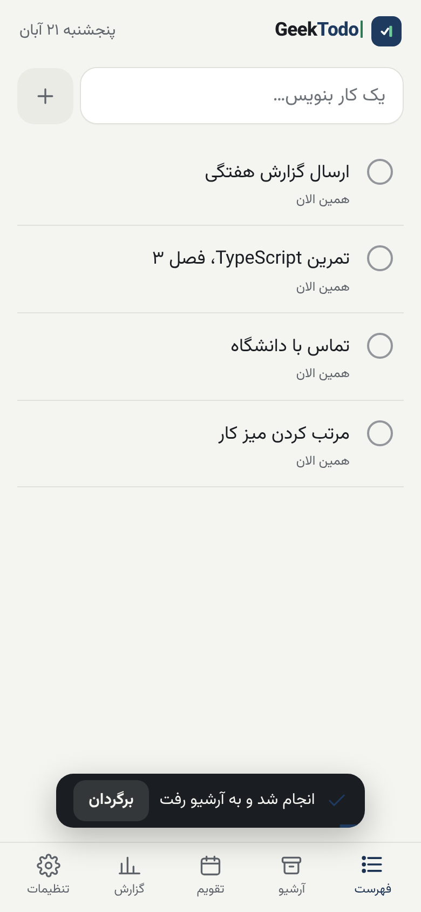
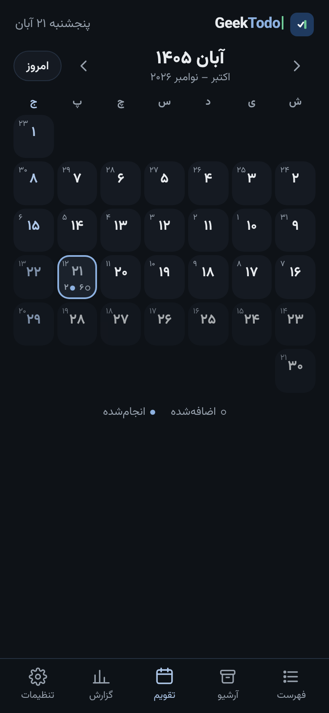

<p align="center">
  
</p>

<h1 align="center">GeekTodo</h1>

<p align="center" dir="rtl">فهرست کارهای شخصی، ساده و آفلاین: هر کار را با خط کشیدن روی آن تمام می‌کنید، مثل یادداشت روی کاغذ.</p>
<p align="center">A simple, offline, personal to-do list in Persian: you finish a task by striking it through, like a note on paper.</p>

<p align="center"><a href="https://mani-imani.github.io/GeekTodo/"><b>mani-imani.github.io/GeekTodo</b></a></p>
<p align="center"><a href="#فارسی">فارسی</a> · <a href="#english">English</a> · <code>v1.2.1</code></p>

---

<div dir="rtl">

## فارسی

### چه کاری می‌کند

GeekTodo فقط کارهای باز را نشان می‌دهد. کار را می‌نویسید و Enter می‌زنید. وقتی انجامش دادید، با انگشت یا ماوس رویش خط می‌کشید و کار به آرشیو می‌رود. سرور ندارد، حساب کاربری ندارد و هیچ داده‌ای از دستگاه شما بیرون نمی‌رود.

### ویژگی‌ها

- **فهرست ساده:** فقط کارهای باز. بنویسید و Enter بزنید.
- **خط کشیدن واقعی:** انگشت را روی کار بکشید و خط دقیقاً دنبالش می‌آید، یا روی دایره بزنید. انیمیشن قلم، صدای ساخته‌شده با Web Audio و لرزش روی اندروید.
- **برگرداندن:** تا چند ثانیه بعد از خط زدن یا حذف، با یک ضربه برمی‌گردد. از آرشیو هم هر وقت خواستید.
- **آرشیو و جست‌وجو:** کارهای انجام‌شده، گروه‌بندی‌شده بر اساس روز، با جست‌وجوی آفلاین. ی و ک عربی و فارسی و رقم‌های فارسی و انگلیسی یکی حساب می‌شوند.
- **جابه‌جایی:** ترتیب کارها با کشیدن دستگیره، با لمس، ماوس یا کلیدهای بالا و پایین عوض می‌شود.
- **کمرنگ شدن:** کاری که مدت زیادی مانده، کم‌کم کمرنگ می‌شود و در آخر می‌پرسد: «انجامش بده یا رهایش کن».
- **تقویم شمسی:** نمای ماهانه، با تعداد کارهای اضافه‌شده و انجام‌شده‌ی هر روز. با زدن روی هر روز، جزئیات و ساعت‌ها را می‌بینید.
- **گزارش:** امروز، این هفته، روزهای پیاپی، نمودار ۱۴ روز و ۱۲ هفته و چند آمار کوچک.
- **شخصی‌سازی:** تم، رنگ تأکید (سرمه‌ای پیش‌فرض است)، فونت، اندازه‌ی متن، رقم‌ها، تقویم، انیمیشن و صدا. هر بخش اضافه را می‌شود خاموش کرد.
- **پشتیبان:** خروجی و ورودی JSON، یادآوری ملایم پشتیبان‌گیری، و درخواست ذخیره‌ی پایدار از مرورگر.
- **اپ:** روی صفحه‌ی اصلی گوشی نصب می‌شود و در حالت هواپیما هم کامل کار می‌کند.

### نمای اپ

<p align="center">
  
  
</p>

### نصب روی گوشی

- **اندروید (Chrome):** سایت را باز کنید و بنر «نصب» را بزنید، یا از منو گزینه‌ی Install app را انتخاب کنید.
- **آیفون (Safari):** دکمه‌ی اشتراک‌گذاری، بعد Add to Home Screen.

### پشتیبان‌گیری

داده‌ها در IndexedDB مرورگر ذخیره می‌شوند. اگر داده‌ی سایت را پاک کنید، یا روی iOS اپ را مدت زیادی باز نکنید، ممکن است مرورگر آن‌ها را پاک کند. برای همین:

1. هر چند وقت یک بار از **تنظیمات ← خروجی JSON** پشتیبان بگیرید.
2. برای برگرداندن داده: **تنظیمات ← ورودی JSON**. کارهای تکراری با <code dir="ltr">id</code> شناخته می‌شوند و نسخه‌ی تازه‌تر (<code dir="ltr">updated_at</code>) می‌ماند، پس وارد کردن دوباره‌ی یک فایل چیزی را خراب نمی‌کند.

### اجرا روی سیستم خودتان

پروژه build step و وابستگی ندارد: فقط HTML، CSS و جاوااسکریپت (ES modules).

```bash
git clone https://github.com/mani-imani/GeekTodo.git
cd GeekTodo
python3 -m http.server 8000
```

بعد <code dir="ltr">http&#58;//localhost:8000</code> را باز کنید. Service Worker فقط روی localhost یا HTTPS کار می‌کند، پس فایل را مستقیم از دیسک باز نکنید.

### انتشار نسخه‌ی تازه

نسخه را **در هر دو جا** بالا ببرید تا کاربرها فایل‌های تازه را بگیرند: <code dir="ltr">sw.js</code> (<code dir="ltr">VERSION</code>) و <code dir="ltr">js/version.js</code> (<code dir="ltr">APP_VERSION</code>). اپ پیام «نسخه‌ی تازه آماده است» را نشان می‌دهد. اگر فایل تازه‌ای اضافه کردید، آن را به آرایه‌ی <code dir="ltr">ASSETS</code> در <code dir="ltr">sw.js</code> هم اضافه کنید.

### ساختار پروژه

```
index.html            پوسته‌ی اپ
manifest.webmanifest  تنظیمات نصب (PWA)
sw.js                 Service Worker، کاملاً آفلاین
css/style.css         همه‌ی استایل‌ها: راست‌به‌چپ، روشن و تیره، رنگ‌های برند
js/main.js            مسیریابی، تم، بنرها، ثبت Service Worker
js/store.js           مدل داده، عملیات، خروجی و ورودی
js/db.js              لایه‌ی سبک IndexedDB
js/jalali.js          تبدیل شمسی و میلادی، بدون کتابخانه
js/fmt.js             قالب تاریخ و رقم‌ها
js/strike.js          رسم خط قلم
js/feedback.js        صدا (Web Audio) و لرزش
js/backup.js          فایل JSON
js/views/             فهرست، آرشیو، تقویم، گزارش، تنظیمات
icons/                آیکون اپ از سیستم برند گیک‌مانی
fonts/                وزیرمتن (OFL)
```

### مدل داده

| فیلد | توضیح |
| --- | --- |
| <code dir="ltr">id</code> | UUID |
| <code dir="ltr">text</code> | متن کار |
| <code dir="ltr">created_at</code> | زمان ساخت (میلی‌ثانیه) |
| <code dir="ltr">done_at</code> | زمان انجام؛ خالی یعنی باز |
| <code dir="ltr">archived_at</code> | زمان رفتن به آرشیو؛ وقتی «رفتن خودکار به آرشیو» خاموش است، تا پاک‌سازی دستی خالی می‌ماند |
| <code dir="ltr">sort_order</code> | ترتیب دستی در فهرست |
| <code dir="ltr">updated_at</code> | آخرین تغییر؛ برای ادغام فایل‌ها و همگام‌سازی آینده |
| <code dir="ltr">deleted</code> | حذف نرم |

فایل خروجی <code dir="ltr">schema_version</code> دارد تا نسخه‌های بعدی بتوانند داده‌ی قدیمی را بخوانند.

### مجوز

کد با مجوز MIT منتشر شده است ([LICENSE](LICENSE)). فونت وزیرمتن از صابر راستی‌کردار، با مجوز SIL OFL 1.1 ([fonts/OFL.txt](fonts/OFL.txt)).

### نسخه

<code dir="ltr">v1.2.1</code> · تغییرات در [CHANGELOG.md](CHANGELOG.md).

</div>

---

## English

### What it does
GeekTodo shows only your open tasks. You type a task and press Enter. When it is done, you strike it through with a finger or the mouse and it moves to the archive. There is no server and no account, and no data leaves your device. The interface is in Persian, right-to-left, with a Persian (Jalali) calendar.

### Features
- **A plain list:** open tasks only. Type and press Enter.
- **A real strike-through:** drag across a task and the line follows your finger, or tap the circle. Pen animation, a sound made with Web Audio, and vibration on Android.
- **Undo:** for a few seconds after striking or deleting, one tap brings it back. From the archive, any time.
- **Archive and search:** finished tasks grouped by day, with offline search. Arabic and Persian ي/ی and ك/ک, and Persian and Latin digits, are treated alike.
- **Reorder:** drag the handle, with touch, mouse or the up and down keys.
- **Fading:** a task left open for a long time slowly fades, and finally asks: do it, or let it go.
- **Persian calendar:** a month view with how many tasks were added and finished each day. Tap a day for the details and times.
- **Report:** today, this week, the streak of active days, a 14-day and a 12-week chart, and a few small stats.
- **Personal settings:** theme, accent color (navy by default), font, text size, digits, calendar, animation and sound. Every extra can be turned off.
- **Backup:** JSON export and import, a gentle backup reminder, and a request for persistent storage.
- **App:** installs on the home screen and works fully in airplane mode.

### Screenshots
<p align="center">
  
  
</p>

### Install on a phone
- **Android (Chrome):** open the site and tap the "install" banner, or choose Install app from the menu.
- **iPhone (Safari):** the Share button, then Add to Home Screen.

### Backup
Data lives in the browser's IndexedDB. If you clear the site's data, or on iOS do not open the app for a long time, the browser may delete it. So:

1. Every now and then, export a backup: **Settings → JSON export**.
2. To restore: **Settings → JSON import**. Duplicates are matched by `id` and the newer copy (`updated_at`) wins, so importing the same file twice breaks nothing.

### Run it locally
No build step and no dependencies: plain HTML, CSS and JavaScript (ES modules).

```bash
git clone https://github.com/mani-imani/GeekTodo.git
cd GeekTodo
python3 -m http.server 8000
```

Then open `http://localhost:8000`. The service worker only runs on localhost or HTTPS, so do not open the file straight from disk.

### Release a new version
Raise the version **in both places** so users get the new files: `sw.js` (`VERSION`) and `js/version.js` (`APP_VERSION`). The app then shows a "new version ready" message. If you add a file, also add it to the `ASSETS` array in `sw.js`.

### Project structure
```
index.html            app shell
manifest.webmanifest  install settings (PWA)
sw.js                 service worker, fully offline
css/style.css         all styles: RTL, light and dark, brand colors
js/main.js            routing, theme, banners, service worker
js/store.js           data model, actions, export and import
js/db.js              thin IndexedDB layer
js/jalali.js          Jalali and Gregorian conversion, no library
js/fmt.js             date and digit formatting
js/strike.js          the pen stroke
js/feedback.js        sound (Web Audio) and vibration
js/backup.js          the JSON file
js/views/             list, archive, calendar, report, settings
icons/                app icon from the GeekMani brand system
fonts/                Vazirmatn (OFL)
```

### Data model
| Field | Meaning |
| --- | --- |
| `id` | UUID |
| `text` | task text |
| `created_at` | created (ms) |
| `done_at` | finished; `null` means open |
| `archived_at` | moved to the archive; stays `null` until a manual clean-up when auto-archive is off |
| `sort_order` | manual order in the list |
| `updated_at` | last change; for merging files and a possible future sync |
| `deleted` | soft delete |

Export files carry a `schema_version` so later versions can read older data.

### License
Code under the MIT license ([LICENSE](LICENSE)). The Vazirmatn font is by Saber Rastikerdar, under the SIL OFL 1.1 ([fonts/OFL.txt](fonts/OFL.txt)).

### Version
`v1.2.1` · see [CHANGELOG.md](CHANGELOG.md).

---

<p align="center"><a href="https://github.com/mani-imani"><b>by GeekMani</b></a> · <a href="https://github.com/mani-imani">از گیک‌مانی</a> · <a href="https://maniimani.ir">maniimani.ir</a></p>
